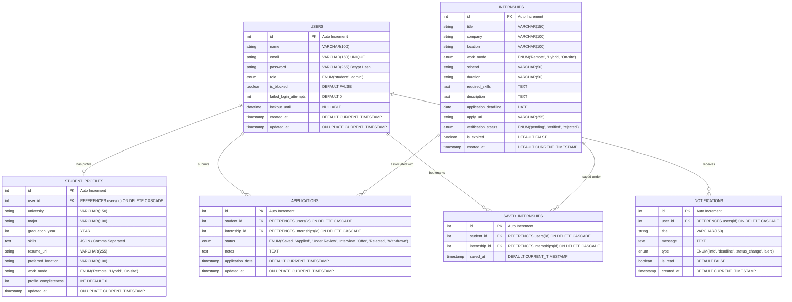
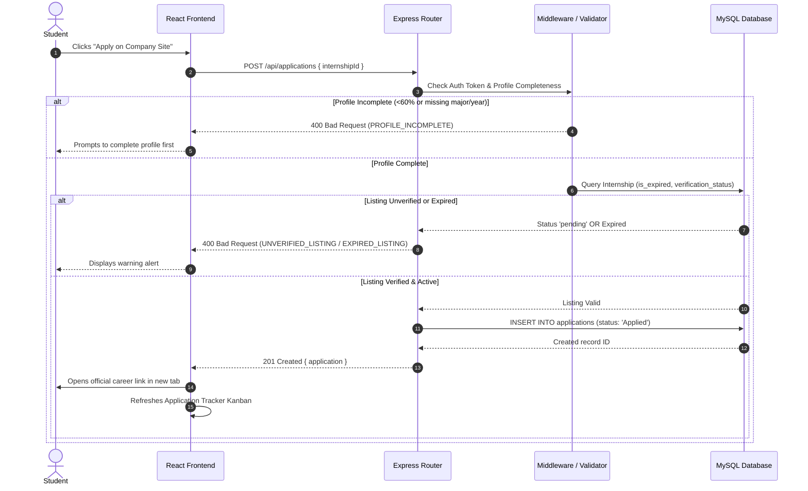
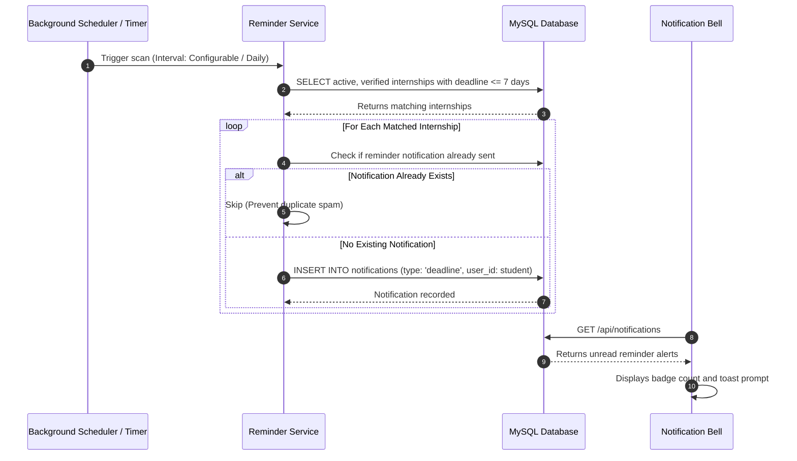

# 🏛️ InternHub — System Architecture & Database Design

## 1. High-Level Architectural Overview
InternHub is engineered as a three-tier, decoupled client-server architecture following modern Software Engineering principles. The system enforces strict separation of concerns between presentation, business logic, data access, and persistent storage.

```mermaid
graph TD
    subgraph ClientLayer ["Client Layer (React 18 + Vite)"]
        UI["Landing & Discovery UI"]
        AuthUI["Login / Register / Lockout Alert"]
        AppTrack["Application Tracker & Kanban"]
        AdminUI["Admin Moderation Console"]
        TestUI["Faculty Viva Test Dashboard"]
        State["Context State (Auth, Toast, Filters)"]
    end

    subgraph APILayer ["API Layer (Express.js 4.19)"]
        Router["Express Router & Dispatcher"]
        CORS["CORS & Request Parsers"]
        Morgan["HTTP Request Logging"]
        
        subgraph Middleware ["Security & Validation Middleware"]
            AuthMid["verifyToken (JWT Bearer)"]
            AdminMid["requireAdmin (Role Authorization)"]
            ValMid["validateRequest (Joi / RegEx)"]
            LockoutMid["Account Lockout Enforcer"]
            ClockMid["Mock Time Controller (Testing)"]
        end
    end

    subgraph ServiceLayer ["Service & Business Logic Layer"]
        AuthSvc["Auth Service (Bcrypt, Lockout)"]
        IntSvc["Internship Discovery Service"]
        AppSvc["Application Pipeline Service"]
        RemindSvc["Deadline Reminder Scheduler"]
        TestRunner["Safe Test Execution Engine"]
    end

    subgraph DataLayer ["Data Access & Storage Layer"]
        Repo["Repository Layer (Parameterized SQL)"]
        Pool["mysql2 Connection Pool (Max 10)"]
        MySQL[("MySQL 8.0 Relational Database")]
        Fallback[("In-Memory Repository Fallback")]
    end

    ClientLayer <-->|HTTP / JSON (REST)| APILayer
    APILayer --> Middleware
    Middleware --> ServiceLayer
    ServiceLayer --> DataLayer
    Repo --> Pool
    Pool --> MySQL
    Repo -.->|If MySQL offline| Fallback
```

---

## 2. Entity-Relationship (ER) Diagram

The database schema utilizes relational constraints, foreign keys with cascading rules, and unique indices to prevent duplicate entries and maintain referential integrity.



---

## 3. Security Architecture & Guardrails

### 3.1 Password Policy & Cryptographic Hashing
- **Specification:** Minimum 8 characters, maximum 15 characters, at least 1 uppercase letter (`A-Z`), at least 1 numeric digit (`0-9`), and at least 1 special character (`!@#$%^&*()_+\-=\[\]{}|;:,.<>?`).
- **Storage:** Passwords are never stored in plain text. When accepted, passwords are salted and hashed using **bcrypt** with a cost factor of 10 (`bcrypt.hash(password, 10)`).
- **Parity:** The exact regular expression and validation rules are shared symmetrically across `server/src/utils/passwordPolicy.js` and `client/src/pages/RegisterPage.jsx`.

### 3.2 Account Lockout Mechanism (TC_LGN_06)
- **Threshold:** 5 consecutive failed login attempts for any account.
- **Lockout Duration:** 15 minutes (`15 * 60 * 1000` ms).
- **Server Enforcement:** Stored persistently in MySQL `failed_login_attempts` and `lockout_until`.
- **Response:** Returns HTTP `423 Locked` with message:  
  `"Account locked for 15 minutes due to too many failed attempts."`
- **Tamper Resistance:** Page refresh, clearing client cookies, or restarting the browser cannot bypass the server lockout.
- **Controllable Testing Clock:** Supports the `x-mock-time` HTTP header during automated tests to test lockout expiration without sleeping for 15 real minutes.
- **Viva Demo Reset:** Provides `POST /api/auth/reset-lockout` for rapid presentation during academic evaluation.

### 3.3 Authorization & Role-Based Access Control (RBAC)
- **Token Format:** Signed JSON Web Token (JWT) with HMAC SHA-256 (`HS256`).
- **Middleware Hierarchy:**
  1. `verifyToken`: Validates Bearer token in the `Authorization` header. Decodes payload (`id`, `email`, `role`).
  2. `requireAdmin`: Rejects non-admin users with HTTP `403 Forbidden` (`ADMIN_ACCESS_REQUIRED`).
  3. `requireActive`: Rejects suspended/blocked student accounts with HTTP `403 Forbidden` (`ACCOUNT_BLOCKED`).

### 3.4 Application Business Rules & Guardrails
- **Incomplete Profile Gate:** Before creating an application record, the server verifies `student_profiles` has non-empty values for required fields. Incomplete profiles receive HTTP `400 Bad Request` (`PROFILE_INCOMPLETE`).
- **Unverified Listing Protection:** Applying to listings with `verification_status != 'verified'` is rejected with HTTP `400 Bad Request` (`UNVERIFIED_LISTING`).
- **Expired Listing Protection:** Applying to listings with `is_expired = TRUE` or past deadlines is rejected with HTTP `400 Bad Request` (`EXPIRED_LISTING`).
- **Duplicate Prevention:** Unique composite constraint on `(student_id, internship_id)` in `applications` and `saved_internships`.

---

## 4. End-to-End Core Data Workflows

### 4.1 Student Application Workflow


### 4.2 Automated Deadline Reminder Scheduler

